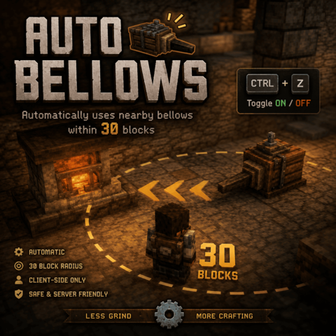

Ось оновлений текст для головної сторінки `README.md`:

```markdown
# Auto Bellows

<p align="center">
  
</p>

---

## ✨ Features

- Automatically activates nearby bellows
- Automatically pours molten metal into ingot and tool molds
- Choose which mold types to use in the **F1 settings menu**
- Adjustable action radius from **1 to 30 blocks**
- Radius and mold preferences are saved automatically
- Automatically follows the game's Ukrainian or English language
- Manual language selection is also available
- Fully client-side; does not modify server logic

---

## ⚙️ How It Works

Once enabled, the mod scans for nearby bellows and automatically interacts with them.

Auto Pouring can fill selected molds when you hold a crucible containing molten metal. Configure the available features, mold types, language, and radius in the settings menu.

Perfect for:
- Smelting and forging
- Pouring metal into molds
- Reducing repetitive actions

---

## 🎮 Controls

| Keybind | Action |
|---|---|
| `F1` | Open the settings menu |
| `Ctrl + Z` | Enable / Disable Auto Bellows |
| `Ctrl + X` | Enable / Disable Auto Pouring |

---

## 📌 Compatibility

- Vintage Story `1.22.7`
- Client-side only

---

## 📥 Installation

1. Download the mod.
2. Remove any older version of Auto Bellows from your `Mods` folder.
3. Place the new `.zip` file into your `Mods` folder.
4. Launch the game.

---

## ⚠️ Notes

- Server reach limits or anti-cheat rules may restrict interactions.
- Version 1.1.6 has been compiled against the 1.22.7 API, but has not yet been tested in-game.
- This mod is provided **"as is"** without warranty.
- Not affiliated with Vintage Story developers.

---

## 📜 License

See the [LICENSE](LICENSE.md) file for details.

---

<p align="center">
  Made by <b>prescko</b>
</p>
```
